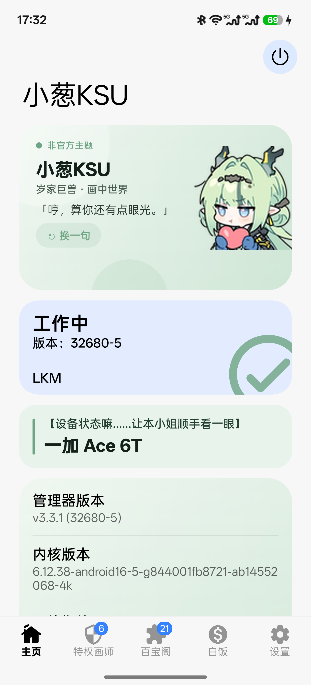

# 小葱KSU（xiaocong-ksu）

基于 **KernelSU v3.3.1** 的管理器主题化二创，配套 **自定义签名 LKM**。

> 非官方主题项目，与 KernelSU 官方无关。仅改 UI 与文案，KernelSU 的 Root / 模块 / 超级用户功能逻辑未改动。

## 特性

- 浅葱绿主题配色（深/浅色两套）
- 首页 Hero 卡：小葱形象 + 18 条小葱语录（可「换一句」）
- 设备状态卡、设备信息卡同步换肤
- 底栏：**主页 / 特权画师 / 百宝阁 / 零食 / 设置**
- 「零食」页：原大肥鱼「白饭」页改版，保留 DeepSeek 余额查询能力
- 启动动画、应用图标、关于页均为小葱主题
- 管理器使用**自定义 v2-only 签名**，配套 LKM 信任该签名
- APK 内置 `android16-6.12` 自定义 LKM（免导入）

## 截图

| 首页 | 关于 |
| --- | --- |
|  |  |

## 版本信息

| 项目 | 值 |
| --- | --- |
| 基座 | KernelSU v3.3.1（Manager 32680 / UAPI 5） |
| 包名 | `me.weishu.kernelsu` |
| versionCode | 32680 |
| 签名 | v2-only，自定义证书 |

### 签名参数

```text
Certificate DER size: 825 bytes (0x0339)
Certificate SHA-256:  627451eeec41f171518af1010c1621008ccdcb04bf7b04622ad1195c4c020ca9
Manager package:      me.weishu.kernelsu
```

LKM 构建时必须使用上述 `KSU_EXPECTED_SIZE` / `KSU_EXPECTED_HASH`，否则内核不认本管理器。

## 构建

### 管理器

需要：JDK 21、Android SDK 37（platform `android-37.0`、build-tools `36.0.0`）、NDK 29、CMake 3.22.1。

```bash
cd manager
./gradlew :app:assembleRelease
```

产物：`manager/app/build/outputs/apk/release/`

签名：参考 `manager/sign.example.properties`，在本地 `manager/gradle.properties` 配置：

```properties
KEYSTORE_FILE=/path/to/your.jks
KEYSTORE_PASSWORD=****
KEY_ALIAS=****
KEY_PASSWORD=****
```

### LKM

构建工作流：`.github/workflows/build-lkm.yml`（使用 `ghcr.io/ylarod/ddk-min` 容器，支持 `android15-6.6` / `android16-6.12` / `android17-6.18`）。

本地构建：

```bash
cd kernel
CONFIG_KSU=m CC=clang make \
  KSU_GIT_VERSION=2680 \
  KSU_VERSION=32680 \
  KSU_EXPECTED_SIZE=0x0339 \
  KSU_EXPECTED_HASH=627451eeec41f171518af1010c1621008ccdcb04bf7b04622ad1195c4c020ca9 \
  KSU_MANAGER_PACKAGE=me.weishu.kernelsu
```

## 安装

1. 用管理器安装页「直接安装」或「选择 boot/init_boot 镜像」，刷入内置 LKM；或手动 `ksud boot-patch`。
2. 安装本 APK。
3. 重启后确认首页显示「工作中」、版本 `32680-5`。

> **注意**：内核只信任本项目的签名。安装官方 KernelSU 或其他二创管理器会导致管理器失联，需重刷对应 LKM。

## 刷机风险

修改 boot/init_boot 存在变砖风险，请先备份启动分区：

```bash
adb shell su -c "dd if=/dev/block/by-name/boot_b of=/sdcard/boot_b.img bs=4M"
adb shell su -c "dd if=/dev/block/by-name/init_boot_b of=/sdcard/init_boot_b.img bs=4M"
```

## 致谢

- [KernelSU](https://github.com/tiann/KernelSU)：内核与管理器基础
- [baifan-ksu-lkm](https://github.com/NekoWannn/baifan-ksu-lkm)：UI 改造思路与主题结构参考
- 小葱形象素材版权归其权利人所有，本项目仅作非官方社区主题使用。

## License

[GPL-3.0](LICENSE)
